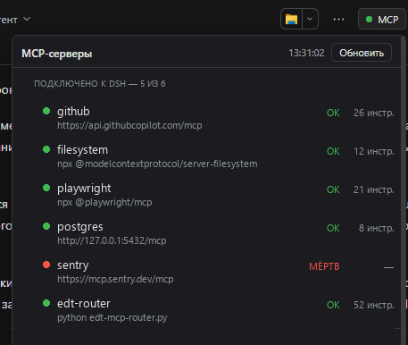

# dsh-mcp-status

A [DeepSeek Harness](https://github.com/deepseek-ai/deepseek-harness) (DSH) plugin that puts an **MCP** button in the chat header. Press it and you see, at a glance, which MCP servers are connected to this Harness and which of them answer *right now* — with the number of tools each one actually exposes.



*Screenshot: the servers shown are examples, not a real configuration.*

*Русское описание — в [README.ru.md](README.ru.md).*

---

## The problem it solves

DSH connects MCP servers once, at startup. When one of them is down, the symptoms are indirect: a tool that used to be in the model's toolset is simply not there, or a call fails with a transport error. The configuration file only tells you what *should* be connected, not what is.

An endpoint that holds a TCP port but never completes the MCP handshake looks "up" to any port checker. This plugin answers a stricter question: **does the server complete `initialize` + `tools/list` right now, and how many tools does it return?** That is the same thing the Harness itself needs in order to give the model those tools.

## What you get

- A compact pill in the chat header (`conversation.session.header.utilities`, the same band as the locale and Markdown controls) with a status dot: green when everything answers, red when something is dead.
- A panel listing every server from the profile configuration: name, transport endpoint, state, response time, tool count.
- A second block for `1C:EDT` instances discovered from each project's `.mcp.json`, so you can see which EDT projects are actually serving MCP.
- A **Refresh** button. The answer is cached, so opening the panel is instant even though a full probe takes ~15 seconds.

---

## How it works

The plugin is two halves in one package, which is the normal shape for a DSH plugin that has a user interface.

```
┌──────────────────────────── Host (Node) ────────────────────────────┐
│  index.js                                                           │
│                                                                     │
│   apply(ctx)                                                        │
│     └─ ctx.effect(...)                                              │
│          ├─ webServer.register({ path: '/plugin/mcp-status', ... }) │
│          ├─ refresh()           ← at startup, then every 5 minutes  │
│          └─ setInterval(...)                                        │
│                                                                     │
│   refresh()                                                         │
│     └─ spawn(python, [mcp_status.py, --json, --out <tmp file>])     │
│          └─ read <tmp file> → JSON → cache { data, fetchedAt }      │
└─────────────────────────────────────────────────────────────────────┘
                                   ▲
                                   │ GET /plugin/mcp-status[?refresh=1]
                                   │ (same origin, plain fetch)
┌──────────────────────────── Client (browser) ───────────────────────┐
│  client.js  →  window.__ModuleLoader__.load({ id, factory })        │
│                                                                     │
│   ctx.slots.register('conversation.session.header.utilities', ...)  │
│     └─ McpStatusButton                                              │
│          ├─ polls the route on mount, then every 20 s               │
│          ├─ while the host reports `refreshing: true`, every 1.5 s  │
│          └─ renders the pill + popover from the JSON it gets back   │
└─────────────────────────────────────────────────────────────────────┘
```

### Why a Python child process instead of probing in JavaScript

The probe is not a port check. For every configured server it performs a real MCP handshake:

1. `POST initialize` with `Accept: application/json, text/event-stream`, following the `307` redirect some servers answer on `/mcp` before `/mcp/`.
2. Capture the `Mcp-Session-Id` header and send `notifications/initialized` — several FastMCP-based servers reject `tools/list` with *"Invalid request parameters"* without it.
3. `POST tools/list` with that session header, parse either a plain JSON body or an SSE stream (`data: {...}` blocks).
4. For `stdio` servers: spawn the configured command, speak newline-delimited JSON-RPC over stdin/stdout, and apply separate timeouts per stage — a router can take 12 seconds on `tools/list` because it rescans its port range first.

That logic already exists as a tested Python script (`scripts/mcp_status.py`, ~800 lines, standard library only). Re-implementing the transport edge cases in JavaScript would be a second source of truth, so the host half simply runs the script and caches its JSON. The plugin therefore ships the script inside the package — no external dependency.

One consequence worth knowing: the child's stdout is **not** captured through a pipe. The script writes its result to a file (`--out <path>`), the plugin reads that file and deletes it. Pipes are fragile under sandboxed shells, and a file handoff works everywhere.

### Wire format

`GET /plugin/mcp-status` returns the cache envelope:

```json
{
  "ok": true,
  "fetchedAt": 1793269934399,
  "durationMs": 14984,
  "refreshing": false,
  "error": null,
  "data": {
    "generatedAt": "2026-10-29T13:32:14",
    "config": "C:\\Users\\me\\.dsh\\profiles\\desktop\\cordis.patch.yml",
    "servers": [
      {
        "name": "1c-edt",
        "transport": "stdio",
        "endpoint": "python.exe edt-mcp-router.py 8760-8790",
        "state": "ok",
        "ms": 12293,
        "tools": 52,
        "detail": ""
      }
    ],
    "commentedOut": ["mcp-1c-metadata"],
    "edt": [
      { "project": "My project", "url": "http://127.0.0.1:8771/mcp", "state": "ok", "tools": 50, "detail": "" }
    ],
    "orphanPorts": []
  }
}
```

`?refresh=1` starts a background probe and returns the previous cache immediately with `refreshing: true`. The UI then polls until `refreshing` flips back, so the timestamp changes when the new result lands — not when the button was pressed.

### Status values

| State | Meaning |
| --- | --- |
| `ok` | Handshake succeeded; `tools` is the number of tools the server returned. |
| `warn` | `initialize` succeeded but `tools/list` failed — the process is alive and broken. `detail` carries the reason. |
| `dead` | Connection refused, timeout, HTTP error, or a non-MCP response. |
| `off` | The config row has `disabled: true`. |
| `skipped` | Not probed (for example an EDT project without a URL). |

---

## Configuration

The plugin reads its configuration from the loader row. All keys are optional:

| Key | Default | Meaning |
| --- | --- | --- |
| `pythonPath` | DSH runtime Python (`~/.dsh/dsh-runtimes/dsh-primary-runtime/dependencies/python/python.exe`) | Interpreter used to run the probe script. |
| `scriptPath` | `scripts/mcp_status.py` inside the package | Probe script. Point it at your own copy to customize. |
| `intervalMs` | `300000` (5 min) | Background refresh period. Minimum enforced: 15 s. |

Override in your profile's `cordis.patch.yml`:

```yaml
- insert:
    - id: mcp-status
      name: '@local/dsh-mcp-status'
      config:
        intervalMs: 60000
```

The probe itself reads the **profile configuration** (`~/.dsh/profiles/<profile>/cordis.patch.yml`) to find `@deepseek-ai/dsh-mcp-client` rows, and each `E:\...`-style project directory's `.mcp.json` for EDT instance ports. It never edits anything.

## Installation

The plugin is a bundle: it ships a `dsh.bundle.patch` that inserts its own loader row.

1. Put the directory somewhere permanent and install it into the profile as a linked dependency:

   ```powershell
   cd ~\.dsh\profiles\desktop
   pnpm add "link:<absolute path to this package>"
   ```

2. Add it to the profile's bundle list in `~/.dsh/profiles/desktop/package.json`:

   ```json
   "dsh": { "profile": { "bundles": [
       "@deepseek-ai/dsh-base",
       "@deepseek-ai/dsh-web-app",
       "@goodandready/dsh-russian-lang",
       "@local/dsh-mcp-status"
   ] } }
   ```

3. Restart DSH. The host half activates with the profile; the client half appears on the next page load.

To remove it, drop the name from `bundles` and run `pnpm install` again.

> The package name `@local/dsh-mcp-status` is arbitrary — it is a private package that is never published to npm. Rename it in `package.json` **and** in `cordis.patch.yml` (plus the profile's dependency key and bundle list) if you want a different one.

## Troubleshooting

| Symptom | Cause / fix |
| --- | --- |
| No button after install | The client half is registered when the page loads. Reload the page (F5), not just the app. |
| Route answers 404 | The host half did not activate. Check the DSH stderr for `[mcp-status]` warnings; confirm the loader row exists and the package resolves from the profile. |
| `cannot get property "webServer" without inject` | Cordis forbids reading a service without declaring it. The plugin declares `export const inject = ['webServer']`. |
| Panel shows "Проверяю…" for ~15 s | Expected: the stdio router rescans its port range on every `tools/list`. HTTP servers alone answer in ~200 ms. |
| `dead` for EDT projects | That EDT instance is not running. `.mcp.json` keeps the port from its last run; this is not an error. |
| Everything `dead` | The probe could not reach anything: check the MCP containers/processes, then press Refresh. |

A diagnostic log is appended to `.activation.log` in the package directory when the module is imported and when `apply` throws. It is git-ignored.

## Known limitations

- The route is a plain `webServer` route, not an authenticated `/api` route. It exposes only MCP server names, endpoints and states on loopback; there is no framework-level auth on it. If you bind DSH to a non-loopback address, this route is reachable too.
- The probe is generic over "servers in the profile config" and "EDT instances"; the EDT block is 1C-specific but harmless in other setups (it simply finds no projects).
- The client half receives no configuration (DSH creates client entries without it), so all tuning lives in the host row.

## License

MIT — see [LICENSE](LICENSE).
