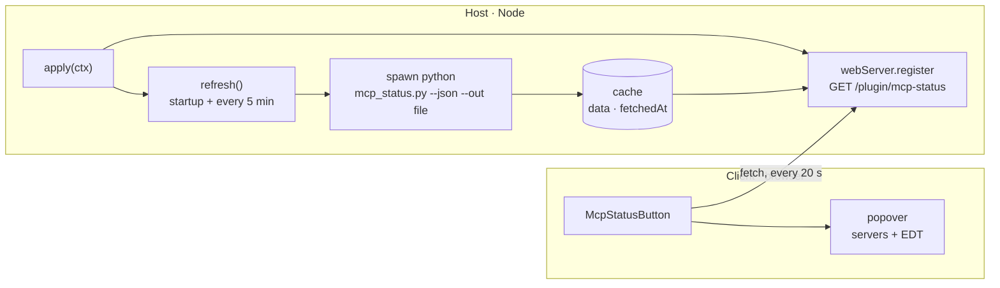

# dsh-mcp-status

**English** · [Русский](README.ru.md)

[](LICENSE)
[](package.json)
[](https://github.com/deepseek-ai/deepseek-harness)
[](#a-handshake-and-not-a-port-check)

> A DeepSeek Harness plugin that puts an **MCP** button in the chat header.
> One click and you see which MCP servers are connected — and which of them
> answer *right now*, with the number of tools each one actually exposes.


*Example servers, addresses and names in the screenshot are placeholders.*

---

## Contents

- [Why this exists](#why-this-exists)
- [What you get](#what-you-get)
- [How it works](#how-it-works)
- [Wire format](#wire-format)
- [States](#states)
- [Configuration](#configuration)
- [Installation](#installation)
- [Standalone probe](#standalone-probe)
- [Troubleshooting](#troubleshooting)
- [Limitations](#limitations)
- [License](#license)

## Why this exists

DSH connects MCP servers once, at startup. When one of them is down, the
symptoms are indirect: a tool that used to be in the model's toolset is simply
not there, or a call fails with a transport error. The configuration file only
tells you what *should* be connected, not what is.

An endpoint that holds a TCP port but never completes the MCP handshake looks
"up" to any port checker. This plugin answers a stricter question: **does the
server complete `initialize` + `tools/list` right now, and how many tools does
it return?** That is the same thing the Harness itself needs in order to give
the model those tools.

## What you get

| Element | Where | What it shows |
| --- | --- | --- |
| Status pill | chat header, `conversation.session.header.utilities` | a dot: green when everything answers, red when something is dead |
| Server list | inside the popover | name, endpoint, state, response time, tool count |
| EDT block | inside the popover | which `1C:EDT` projects are currently serving MCP, discovered from each project's `.mcp.json` |
| Refresh button | popover header | forces a probe; the timestamp changes when the new result lands |

The answer is cached, so opening the panel is instant even though a full probe
takes ~15 seconds.

## How it works

Two halves in one package — the usual shape for a DSH plugin with a UI.



### Host half — `index.js`

Declares `export const inject = ['webServer']`, registers the route inside
`ctx.effect`, and runs the probe at startup and then every five minutes. The
probe is a child process: it writes JSON to a file, the plugin reads that file,
caches it and serves it.

### Client half — `client.js`

A classic script that registers itself through `window.__ModuleLoader__.load`
and exports `{ inject: ['slots'], apply(ctx) }`. It places a React component
into the `conversation.session.header.utilities` slot — the same band as the
locale and Markdown controls. The component polls the route on mount, then
every 20 seconds; while the host reports `refreshing: true` it polls every
1.5 seconds, so the timestamp changes the moment the result is ready instead of
half a minute later.

### A handshake and not a port check

For every configured server the probe performs a real MCP handshake:

1. `POST initialize` with `Accept: application/json, text/event-stream`, following
   the `307` redirect some servers answer on `/mcp` before `/mcp/`.
2. Capture `Mcp-Session-Id` and send `notifications/initialized` — several
   FastMCP-based servers reject `tools/list` with *"Invalid request parameters"*
   without it.
3. `POST tools/list` with that session header; parse either a plain JSON body or
   an SSE stream (`data: {...}` blocks).
4. For `stdio` servers: spawn the configured command, speak newline-delimited
   JSON-RPC over stdin/stdout, with separate timeouts per stage — a router can
   take 12 seconds on `tools/list` because it rescans its port range first.

### Why a Python child process

That logic already exists as a tested Python script (`scripts/mcp_status.py`,
standard library only). Re-implementing the transport edge cases in JavaScript
would create a second source of truth, so the host half simply runs the script
and caches its JSON. The script ships inside the package — no external
dependency.

One consequence worth knowing: the child's stdout is **not** captured through a
pipe. The script writes its result to a file (`--out`), the plugin reads and
deletes it. Pipes are fragile under sandboxed shells; a file handoff works
everywhere.

## Wire format

`GET /plugin/mcp-status` returns the cache envelope:

```json
{
  "ok": true,
  "fetchedAt": 1793269934399,
  "durationMs": 14984,
  "refreshing": false,
  "error": null,
  "data": {
    "generatedAt": "2026-10-29T13:32:14",
    "config": "C:\\Users\\me\\.dsh\\profiles\\desktop\\cordis.patch.yml",
    "servers": [
      {
        "name": "edt-router",
        "transport": "stdio",
        "endpoint": "python edt-mcp-router.py",
        "state": "ok",
        "ms": 12293,
        "tools": 52,
        "detail": ""
      },
      {
        "name": "postgres",
        "transport": "http",
        "endpoint": "http://10.20.30.40:8000/mcp",
        "state": "dead",
        "ms": 2041,
        "tools": null,
        "detail": "порт закрыт (connection refused)"
      }
    ],
    "commentedOut": ["mcp-metadata"],
    "edt": [
      {
        "project": "My project",
        "url": "http://10.20.30.41:8765/mcp",
        "state": "ok",
        "tools": 50,
        "detail": ""
      }
    ],
    "orphanPorts": []
  }
}
```

*Addresses above are examples and do not belong to any real network.*

`?refresh=1` starts a background probe and immediately returns the previous
cache with `refreshing: true`. The UI keeps polling until `refreshing` flips
back.

## States

| State | Meaning |
| --- | --- |
| `ok` | Handshake succeeded; `tools` is what the server returned. |
| `warn` | `initialize` succeeded, `tools/list` failed: alive but broken. `detail` carries the reason. |
| `dead` | Connection refused, timeout, HTTP error, or a non-MCP response. |
| `off` | The config row has `disabled: true`. |
| `skipped` | Not probed (for example an EDT project without a URL). |

## Configuration

All keys are optional and live in the loader row:

| Key | Default | Meaning |
| --- | --- | --- |
| `pythonPath` | the DSH runtime Python | Interpreter for the probe script. |
| `scriptPath` | `scripts/mcp_status.py` in the package | Your own copy if you change the probe. |
| `intervalMs` | `300000` (5 min) | Background refresh period; minimum 15 s. |

```yaml
- insert:
    - id: mcp-status
      name: '@local/dsh-mcp-status'
      config:
        intervalMs: 60000
```

## Installation

The package is a bundle: it ships a `dsh.bundle.patch` that inserts its own
loader row.

1. Link it into the profile:

   ```powershell
   cd ~\.dsh\profiles\desktop
   pnpm add "link:<absolute path to this package>"
   ```

2. Add the name to the bundle list in `~/.dsh/profiles/desktop/package.json`:

   ```json
   "dsh": {
     "profile": {
       "bundles": ["@deepseek-ai/dsh-base", "@deepseek-ai/dsh-web-app", "@local/dsh-mcp-status"]
     }
   }
   ```

3. Restart DSH. The host half activates with the profile; the client half
   appears on the next page load.

To remove it, drop the name from `bundles` and run `pnpm install` again.

> [!NOTE]
> The name `@local/dsh-mcp-status` is arbitrary: a private package that is never
> published to npm. Rename it in `package.json` **and** in `cordis.patch.yml`,
> plus the profile's dependency key and bundle list.

## Standalone probe

`scripts/mcp_status.py` runs without the UI:

```bash
python scripts/mcp_status.py                            # human-readable table
python scripts/mcp_status.py --json                     # machine-readable
python scripts/mcp_status.py --json --out result.json   # write to a file
python scripts/mcp_status.py --no-edt                   # skip the 1C:EDT block
python scripts/mcp_status.py --edt-roots 'D:\projects'  # EDT roots, when the router row carries none
```

Exit code `1` means at least one server is dead, `0` means all answered — handy
for cron.

## Troubleshooting

| Symptom | Cause / fix |
| --- | --- |
| No button after install | The client half is registered on page load. Reload the page (F5), not just the app. |
| Route answers 404 | The host half did not activate. Look for `[mcp-status]` warnings in the DSH stderr; check the loader row and that the package resolves from the profile. |
| `cannot get property "webServer" without inject` | Cordis forbids reading a service without declaring it. The plugin declares `inject = ['webServer']`. |
| "Checking…" for ~15 s | Expected: the stdio router rescans its port range on every `tools/list`. HTTP servers alone answer in ~200 ms. |
| `dead` for EDT projects | That EDT instance is not running. `.mcp.json` keeps the port from its last run — not an error. |
| Everything is `dead` | Nothing is reachable: check the MCP processes/containers, then press Refresh. |

The package appends `.activation.log` next to itself when the module is imported
and when `apply` throws. It is git-ignored.

## Limitations

- The route is a plain `webServer` route, not an authenticated `/api` route. It
  exposes only names, endpoints and states on loopback, but if you bind DSH to a
  non-loopback address, this route is reachable too.
- The EDT block is 1C-specific; elsewhere it simply finds no projects.
- The client half receives no configuration (DSH creates client entries without
  it), so all tuning lives in the host row.

## License

[MIT](LICENSE)
