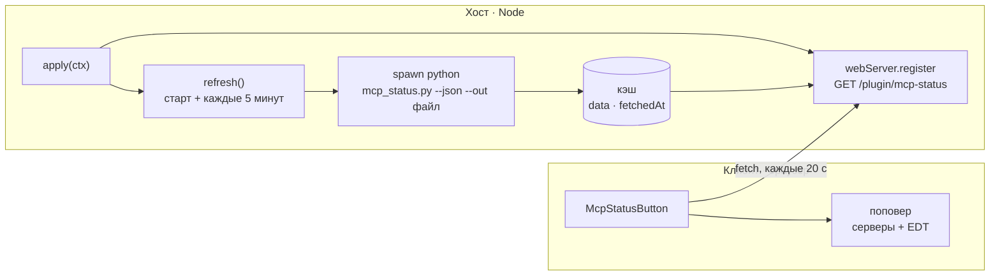

# dsh-mcp-status

[English](README.md) · **Русский**

[](LICENSE)
[](package.json)
[](https://github.com/deepseek-ai/deepseek-harness)
[](#хендшейк-а-не-проверка-порта)

> Плагин для DeepSeek Harness: кнопка **MCP** в шапке чата.
> Одно нажатие — и видно, какие MCP-серверы подключены и какие из них отвечают
> *прямо сейчас*, с числом доступных инструментов у каждого.


*На скриншоте — вымышленные серверы; адреса и названия приведены как пример.*

---

## Содержание

- [Зачем это нужно](#зачем-это-нужно)
- [Что видно](#что-видно)
- [Как устроено](#как-устроено)
- [Формат ответа](#формат-ответа)
- [Состояния](#состояния)
- [Настройка](#настройка)
- [Установка](#установка)
- [Скрипт без интерфейса](#скрипт-без-интерфейса)
- [Диагностика](#диагностика)
- [Ограничения](#ограничения)
- [Лицензия](#лицензия)

## Зачем это нужно

DSH подключает MCP-серверы один раз, при старте. Когда сервер лежит, это
видно косвенно: в наборе инструментов модели просто нет его инструментов, либо
вызов падает с транспортной ошибкой. Конфиг говорит, что *должно* быть
подключено, но не что подключено.

Порт, который кто-то слушает, — ещё не живой MCP-сервер: он может принимать
соединение и не отвечать по протоколу. Плагин проверяет строже: **проходит ли
сервер `initialize` + `tools/list` именно сейчас и сколько инструментов он
вернул.** Это ровно то, что нужно самому Harness, чтобы дать модели эти
инструменты.

## Что видно

| Элемент | Где | Что показывает |
| --- | --- | --- |
| Пилюля состояния | шапка чата, `conversation.session.header.utilities` | точку: зелёная — всё отвечает, красная — что-то мертво |
| Список серверов | в поповере | имя, эндпоинт, состояние, время ответа, число инструментов |
| Блок EDT | в поповере | какие проекты `1C:EDT` сейчас отдают MCP — по `.mcp.json` каждого проекта |
| Кнопка «Обновить» | в шапке поповера | запускает проверку; время меняется, когда готов новый результат |

Ответ кэшируется, поэтому панель открывается мгновенно, хотя полная проверка
идёт ~15 секунд.

## Как устроено

Две половины в одном пакете — обычная форма плагина DSH с интерфейсом.



### Хост — `index.js`

Объявляет `export const inject = ['webServer']`, регистрирует маршрут внутри
`ctx.effect` и запускает проверку при старте, а затем раз в пять минут.
Проверка — дочерний процесс: он пишет JSON в файл, плагин читает файл,
кэширует и раздаёт.

### Клиент — `client.js`

Классический скрипт, который регистрируется через
`window.__ModuleLoader__.load` и экспортирует
`{ inject: ['slots'], apply(ctx) }`. Кладёт React-компонент в слот
`conversation.session.header.utilities` — ту же полосу, где кнопки локали и
Markdown. Компонент опрашивает маршрут при монтировании, затем каждые
20 секунд; пока хост сообщает `refreshing: true`, опрос идёт каждые 1,5
секунды, чтобы время менялось сразу по готовности результата, а не через
полминуты.

### Хендшейк, а не проверка порта

Для каждого сервера выполняется настоящий MCP-хендшейк:

1. `POST initialize` с `Accept: application/json, text/event-stream` и
   переходом по `307`-редиректу, который некоторые серверы отдают на `/mcp`
   перед `/mcp/`.
2. Запоминается `Mcp-Session-Id`, отправляется `notifications/initialized` — без
   него часть серверов на FastMCP отвечает на `tools/list` ошибкой
   *Invalid request parameters*.
3. `POST tools/list` с этим заголовком; ответ разбирается и как обычный JSON,
   и как SSE-поток (`data: {...}`).
4. Для `stdio`-серверов — запуск команды и обмен JSON-RPC по stdin/stdout, с
   отдельными таймаутами на этапы: роутеру нужно ~12 секунд на `tools/list`,
   потому что он заново обходит диапазон портов.

### Почему Python, а не JavaScript

Эта логика уже существует в виде проверенного скрипта
(`scripts/mcp_status.py`, только стандартная библиотека). Второй источник истины
на JavaScript неизбежно разошёлся бы с первым, поэтому хост-часть запускает
скрипт и кэширует его JSON. Скрипт включён в пакет — внешних зависимостей нет.

Вывод дочернего процесса намеренно **не** забирается через pipe: скрипт пишет
результат в файл (`--out`), плагин читает и удаляет его. Pipes ломаются в
песочницах, а файл работает везде.

## Формат ответа

`GET /plugin/mcp-status` отдаёт конверт с кэшем:

```json
{
  "ok": true,
  "fetchedAt": 1793269934399,
  "durationMs": 14984,
  "refreshing": false,
  "error": null,
  "data": {
    "generatedAt": "2026-10-29T13:32:14",
    "config": "C:\\Users\\me\\.dsh\\profiles\\desktop\\cordis.patch.yml",
    "servers": [
      {
        "name": "edt-router",
        "transport": "stdio",
        "endpoint": "python edt-mcp-router.py",
        "state": "ok",
        "ms": 12293,
        "tools": 52,
        "detail": ""
      },
      {
        "name": "postgres",
        "transport": "http",
        "endpoint": "http://10.20.30.40:8000/mcp",
        "state": "dead",
        "ms": 2041,
        "tools": null,
        "detail": "connection refused"
      }
    ],
    "commentedOut": ["mcp-metadata"],
    "edt": [
      {
        "project": "My project",
        "url": "http://10.20.30.41:8765/mcp",
        "state": "ok",
        "tools": 50,
        "detail": ""
      }
    ],
    "orphanPorts": []
  }
}
```

*Адреса в примере вымышленные и не относятся к какой-либо реальной сети.
`detail` — свободный диагностический текст от скрипта проверки.*

`?refresh=1` запускает проверку в фоне и сразу возвращает предыдущий кэш с
`refreshing: true`. Интерфейс опрашивает маршрут, пока флаг не снимется.

## Состояния

| Состояние | Значение |
| --- | --- |
| `ok` | Хендшейк прошёл; `tools` — сколько инструментов вернул сервер. |
| `warn` | `initialize` прошёл, `tools/list` — нет: процесс живой, но сломан. Причина в `detail`. |
| `dead` | Отказ соединения, таймаут, HTTP-ошибка или ответ не по протоколу. |
| `off` | В конфиге стоит `disabled: true`. |
| `skipped` | Не проверялся (например, проект EDT без адреса). |

## Настройка

Все ключи необязательные и задаются в строке загрузчика:

| Ключ | По умолчанию | Смысл |
| --- | --- | --- |
| `pythonPath` | Python из рантайма DSH | Интерпретатор для скрипта проверки. |
| `scriptPath` | `scripts/mcp_status.py` в пакете | Своя копия, если меняешь проверку. |
| `intervalMs` | `300000` (5 минут) | Период фонового обновления, минимум 15 секунд. |

```yaml
- insert:
    - id: mcp-status
      name: '@local/dsh-mcp-status'
      config:
        intervalMs: 60000
```

## Установка

Пакет — это бандл: он несёт `dsh.bundle.patch`, который вставляет собственную
строку загрузчика.

1. Связать пакет с профилем:

   ```powershell
   cd ~\.dsh\profiles\desktop
   pnpm add "link:<абсолютный путь к пакету>"
   ```

2. Добавить имя в список бандлов в `~/.dsh/profiles/desktop/package.json`:

   ```json
   "dsh": {
     "profile": {
       "bundles": ["@deepseek-ai/dsh-base", "@deepseek-ai/dsh-web-app", "@local/dsh-mcp-status"]
     }
   }
   ```

3. Перезапустить DSH. Хост-часть поднимается вместе с профилем, клиентская
   появляется после перезагрузки страницы.

Удаление: убрать имя из `bundles` и выполнить `pnpm install`.

> [!NOTE]
> Имя `@local/dsh-mcp-status` произвольное: пакет приватный и в npm не
> публикуется. Меняйте его в `package.json` **и** в `cordis.patch.yml`, а также
> в зависимостях и списке бандлов профиля.

## Скрипт без интерфейса

`scripts/mcp_status.py` работает и сам по себе:

```bash
python scripts/mcp_status.py                            # таблица для человека
python scripts/mcp_status.py --json                     # машинный вывод
python scripts/mcp_status.py --json --out result.json   # записать в файл
python scripts/mcp_status.py --no-edt                   # без блока 1C:EDT
python scripts/mcp_status.py --edt-roots 'D:\projects'  # каталоги EDT, если роутер их не передал
```

Код возврата: `1` — есть мёртвые серверы, `0` — все живы. Удобно для cron.

## Диагностика

| Симптом | Причина и что делать |
| --- | --- |
| Кнопки нет после установки | Клиентская половина регистрируется при загрузке страницы. Обнови страницу (F5), а не только приложение. |
| Маршрут отдаёт 404 | Хост-часть не активировалась. Ищи в stderr DSH строки `[mcp-status]`; проверь строку загрузчика и что пакет резолвится из профиля. |
| `cannot get property "webServer" without inject` | Cordis запрещает читать сервис без объявления. В плагине есть `inject = ['webServer']`. |
| «Проверяю…» висит ~15 с | Так и должно быть: stdio-роутер каждый раз обходит порты. Только HTTP-серверы отвечают за ~200 мс. |
| `МЁРТВ` у проектов EDT | Инстанс EDT не запущен; в `.mcp.json` остался порт с прошлого запуска — это не ошибка. |
| Все серверы `МЁРТВ` | Ничего не доступно: проверь процессы и контейнеры MCP, затем нажми «Обновить». |

При импорте модуля и при ошибке `apply` рядом с пакетом дописывается
`.activation.log` (в git не попадает).

## Ограничения

- Маршрут зарегистрирован напрямую на веб-сервере, а не через
  аутентифицированный `/api`. Наружу отдаются только имена, эндпоинты и
  состояния, но если опубликовать DSH на не-loopback адрес, маршрут тоже станет
  доступен.
- Блок EDT специфичен для 1С; в других конфигурациях он просто ничего не находит.
- Клиентская половина не получает конфиг (DSH создаёт клиентские записи без
  него), поэтому все настройки живут в строке загрузчика.

## Лицензия

[MIT](LICENSE)
